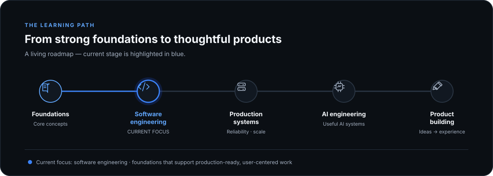

<!-- Copy into the root README.md of the GitHub profile repository and replace every placeholder. -->

  

  <strong>Developing software engineer with a product-design mindset.</strong> 
  Learning with intention and building toward useful, thoughtful products.

 

## My learning roadmap

  

### Current focus

**Software engineering** — strengthening the habits and skills that help turn ideas into maintainable, reliable software.

### The path

1. **Foundations** — programming fundamentals, problem solving, and core concepts.
2. **Software engineering** — maintainable code, architecture, collaboration, and testing.
3. **Production systems** — deployment, reliability, observability, and operating real software.
4. **AI engineering** — building useful AI-powered systems with sound engineering practice.
5. **Product building** — turning user needs into complete, polished products.

  

## A little about me

- I’m **Homafar Sharifi** (`[@HomafarSharifi](https://github.com/HomafarSharifi)`).
- I care about the connection between **good engineering** and **good product experiences**.
- I’m currently learning **Database** and practicing **Python**.
- I’m working toward building software that is useful, reliable, and easy to use.

## Connect

- [LinkedIn](https://www.linkedin.com/in/your-handle/)
- [Email](homafarSharifi@gmail.com)

<!-- Keep the learning path as the main story. This template intentionally has no project showcase. -->
